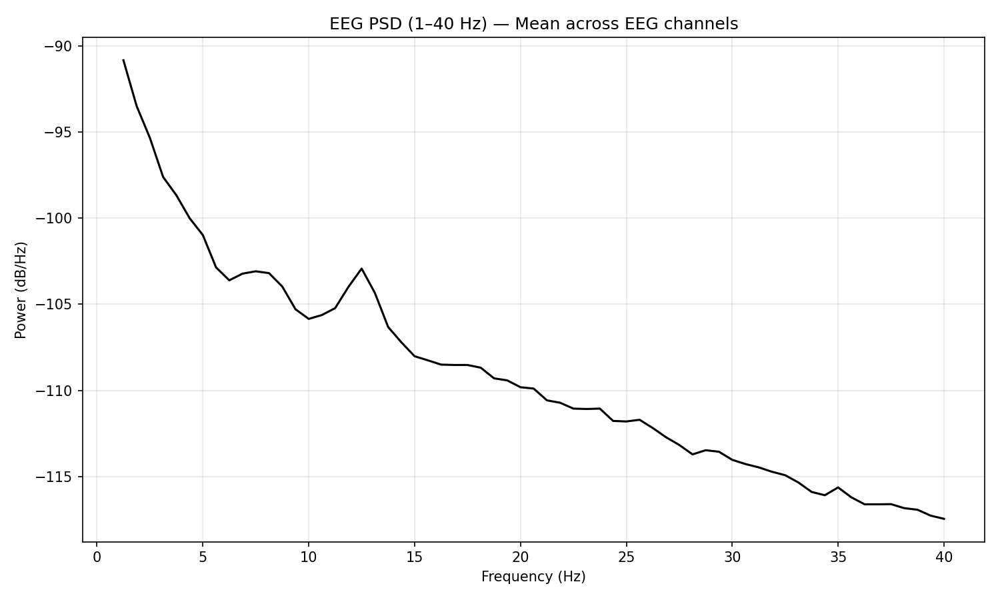
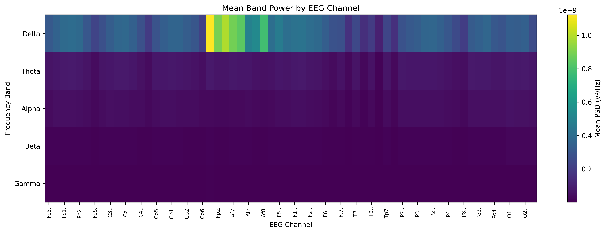
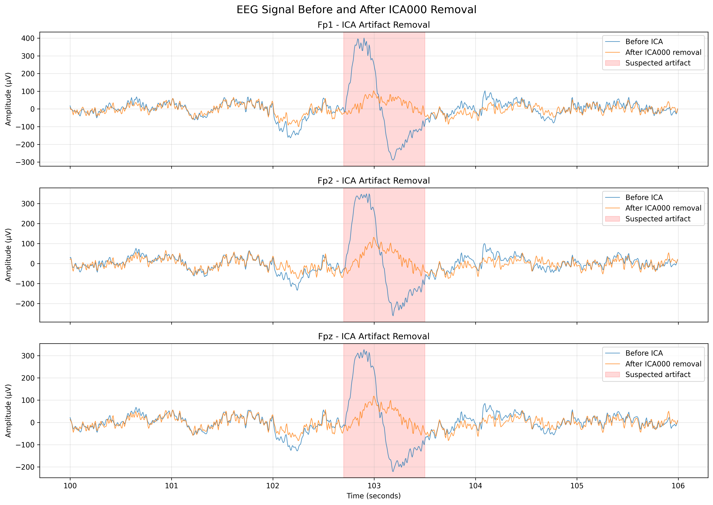
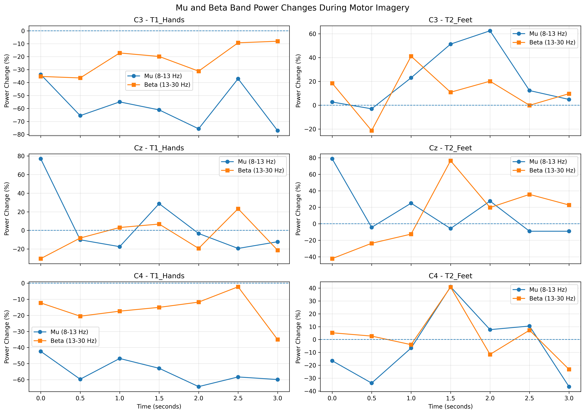

# EEG Analysis Portfolio

A practical EEG signal processing and analysis portfolio built with **Python** and **MNE-Python**.

This repository demonstrates reproducible workflows for EEG preprocessing, spectral analysis, frequency-band feature extraction, ICA-based artifact exploration, automated reporting, and motor imagery analysis.

## About This Portfolio

This portfolio focuses on practical EEG data analysis, scientific computing, and reproducible signal processing workflows.

The projects are organized to demonstrate different stages of EEG analysis, from data inspection and preprocessing to feature extraction, artifact exploration, and condition-level analysis.

The work is intended as a technical learning and demonstration portfolio rather than a clinical or validated BCI system.

## Technical Skills

### Programming and Scientific Computing

- Python
- MNE-Python
- NumPy
- Pandas
- SciPy
- Matplotlib
- Jupyter Notebook

### EEG Signal Processing

- EEG data loading and inspection
- Signal filtering and preprocessing
- Data quality assessment
- Power spectral density (PSD) estimation
- Frequency-band feature extraction
- Absolute and relative band-power analysis
- Independent Component Analysis (ICA)
- Event annotation and epoch analysis
- Sliding-window spectral analysis
- Automated report generation

## Projects

### Project 01 — EEG Preprocessing and PSD

**Focus:** EEG data inspection, preprocessing, filtering, and spectral analysis.

Key tasks:
- Load and inspect EEG recordings.
- Review channel information and sampling properties.
- Apply basic signal filtering.
- Estimate power spectral density.
- Visualize frequency-domain characteristics.

[View Project 01](Project_01_EEG_Preprocessing_PSD/)

### Project 02 — EEG Band Power Features

**Focus:** Frequency-band feature extraction and visualization.

Key tasks:
- Extract Delta, Theta, Alpha, Beta, and Gamma band features.
- Calculate absolute and relative band-power measures.
- Generate channel-level feature tables.
- Visualize spatial patterns using heatmaps.

[View Project 02](Project_02_EEG_BandPower_Features/)

### Project 03 — ICA Artifact Removal

**Focus:** Exploring EEG artifacts and ICA-based component removal.

Key tasks:
- Fit an ICA model to EEG recordings.
- Inspect independent components.
- Explore potentially artifact-related components.
- Compare signals before and after component exclusion.
- Record component-selection decisions.

ICA component interpretation is exploratory and should not be treated as definitive artifact identification without additional evidence.

[View Project 03](Project_03_ICA_Artifact_Removal/)

### Project 04 — Automated EEG Analysis Report

**Focus:** Automated EEG quality assessment and analysis reporting.

Key tasks:
- Load preprocessed and ICA-cleaned EEG data.
- Calculate channel-level quality indicators.
- Extract frequency-band features.
- Generate analysis figures and CSV outputs.
- Produce a self-contained HTML report.

This project uses data processed in Project 03 rather than independently repeating the complete preprocessing workflow.

[View Project 04](Project_04_Automated_EEG_Report/)

### Project 05 — Motor Imagery EEG Analysis

**Focus:** Exploratory Mu and Beta band-power analysis across event conditions.

Key tasks:
- Inspect event annotations.
- Extract event-related epochs.
- Calculate Mu (8–13 Hz) and Beta (13–30 Hz) band power.
- Apply sliding-window spectral analysis.
- Compare condition-level patterns across selected motor-related channels.

The analysis is exploratory. It does not establish validated ERD/ERS effects or demonstrate BCI classification performance.

[View Project 05](Project_05_Motor_Imagery_BandPower/)
## Selected Results

Representative visualizations generated from the EEG analysis projects.

### 1. EEG Power Spectral Density

**Project 01 — EEG Preprocessing and PSD**



### 2. Frequency Band Power Heatmap

**Project 02 — EEG Band Power Features**



### 3. ICA Artifact Removal Comparison

**Project 03 — ICA Artifact Removal**



### 4. Motor Imagery Mu and Beta Band-Power Changes

**Project 05 — Motor Imagery Band-Power Analysis**


## Analysis Workflow

The projects cover the following general workflow:

1. Load EEG recordings.
2. Inspect channel information and sampling properties.
3. Assess basic data quality.
4. Preprocess and filter EEG signals.
5. Estimate power spectral density.
6. Extract frequency-band features.
7. Explore artifacts using ICA.
8. Generate automated analysis reports.
9. Analyze event-related epochs and time-varying spectral features.

## Repository Structure

```text
EEG-Analysis-Portfolio/
│
├── Project_01_EEG_Preprocessing_PSD/
├── Project_02_EEG_BandPower_Features/
├── Project_03_ICA_Artifact_Removal/
├── Project_04_Automated_EEG_Report/
├── Project_05_ERP_Analysis/
│
├── README.md
├── requirements.txt
└── .gitignore
```

Each project contains its own documentation, notebooks, and relevant analysis outputs.

## Environment Setup

### Requirements

- Python
- MNE-Python
- NumPy
- SciPy
- Pandas
- Matplotlib
- Jupyter Notebook

The development environment used for this portfolio includes Python 3.14.6 and MNE-Python 1.12.1. Compatibility should be verified when using a different Python environment.

### Install Dependencies

Clone the repository:

```bash
git clone https://github.com/loseeye/EEG-Brain-Analysis.git
```

Navigate to the repository directory:

```bash
cd EEG-Brain-Analysis
```

Install the dependencies:

```bash
pip install -r requirements.txt
```

### Launch Jupyter Notebook

```bash
jupyter notebook
```

Open the relevant notebook inside the corresponding project's `notebooks/` directory.

For reproducible execution, follow the data path configuration and execution instructions in each project's README.

## Data Availability

Raw EEG recordings, intermediate signal files, and fitted ICA models are not included in this public repository.

Users must obtain the required datasets from their original authorized sources and configure the corresponding data paths before running the notebooks.

Please refer to each project's README for dataset requirements and data preparation instructions.

## Reproducibility and Limitations

- The notebooks are designed to demonstrate practical EEG analysis workflows.
- Some projects use ICA-cleaned data generated by earlier projects.
- Project 05 contains exploratory condition-level comparisons.
- Event labels and experimental meanings should be verified against the original dataset documentation.
- Frequency-band power estimates depend on the selected frequency ranges and analysis parameters.
- ICA component removal requires careful interpretation and should not be considered automatic ground-truth artifact identification.
- The analyses are not clinical findings or validated BCI classification results.

## Disclaimer

This repository is an independent learning and technical demonstration project.

It is intended for educational and research-oriented exploration of EEG signal processing. It is not intended for clinical diagnosis, medical decision-making, or direct clinical use.

## Author

**GitHub:** [SanfranciscoLab](https://github.com/SanfranciscoLab)
